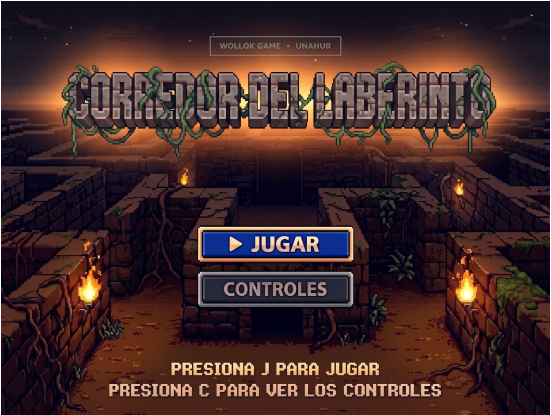
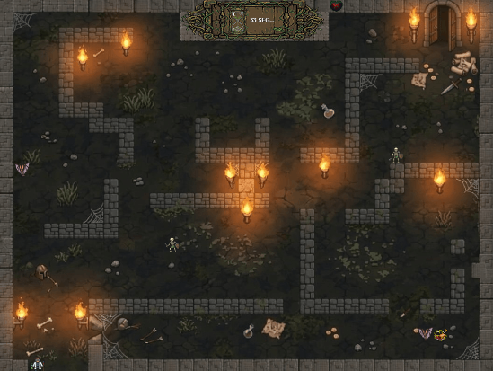

# El Corredor del Laberinto

Juego 2D de exploración y supervivencia a contrarreloj desarrollado en **Wollok Game**, donde deberás recorrer un laberinto para conseguir la llave y escapar antes de que se agote el tiempo, evitando trampas y monstruos.

## Capturas

## Reglas de Juego e Instrucciones

Al iniciar la partida puedes consultar los controles o elegir entre **3 personajes (arquetipos)**, cada uno con distintas estadísticas y ventajas para afrontar el recorrido. El tiempo base de partida es de **45 segundos**, modificado según el personaje elegido.

### Controles

| Tecla | Acción |
| :--- | :--- |
| **`J`** | Ir a la selección de personaje (desde el menú) |
| **`C`** | Ver pantalla de controles (desde el menú) |
| **`1` / `2` / `3`** | Elegir personaje (Exploradora, Ingenioso o Tanque) |
| **`↑` `↓` `←` `→`** | Mover al personaje por el laberinto |
| **`Enter`** | Volver al menú principal (desde Controles, Victoria o Game Over) |

### Personajes

| Personaje | Vidas | Tiempo total | Características |
| :--- | :---: | :---: | :--- |
| **Exploradora** | 2 | 55 seg (+10s) | Cuenta con tiempo extra para explorar el mapa. |
| **Ingenioso** | 1 | 45 seg (+0s) | Ve todas las trampas durante toda la partida (45s) y puede moverse desde el primer segundo sin esperar. |
| **Tanque** | 3 | 30 seg (-15s) | Mayor resistencia al daño, pero dispone de menos tiempo. |

### Niveles y Mecánicas

* **Nivel 1 (Búsqueda de la llave):** Debes encontrar y abrir los **3 cofres** dispersos por el laberinto para obtener la llave que habilita la salida.
  * **Trampas:** Son visibles durante los primeros 3 segundos (45 segundos si juegas con el Ingenioso) y luego se vuelven invisibles. Si las pisas, te inmovilizan durante **2 segundos**.
  * **Poción de tiempo:** Suma **5 segundos** extra al reloj.
* **Nivel 2 (Escape de monstruos):** Una vez cruzada la salida del primer nivel, deberás sobrevivir a los enemigos y llegar a la meta.
  * **Poción de vida:** Recupera **1 vida** (hasta un máximo de 3).

### Enemigos (Nivel 2)

* **Murciélago:** Patrulla en línea recta e invierte su dirección cada vez que choca contra una pared.
* **Esqueleto:** Patrulla de forma aleatoria por el mapa y persigue al personaje cuando entra dentro de su rango de visión (5 casillas).
* *Nota:* Al colisionar con cualquier monstruo se descuenta **1 vida**.

### Victoria y Derrota

* **Derrota (Game Over):** Ocurre si el personaje pierde todas sus vidas o si el temporizador llega a `0`.
* **Victoria:** Se alcanza al llegar a la salida del **Nivel 2**.

## Equipo de Desarrollo

* BENITEZ, MATIAS EZEQUIEL
* CASTILLO, MATHEO NEHUEN
* CATALANO, SANTIAGO NEHUEN
* PAEZ VEGA, ROMÁN DARIO
* SCHWAB, FRANCISCO VALENTIN

## Otros

* **Materia:** Programación con Objetos 1 — Universidad Nacional de Hurlingham (UNAHUR)
* **Versión de Wollok:** `1.1.1`
* **Visibilidad:** Una vez terminado, no tenemos problemas en que el repositorio sea público.